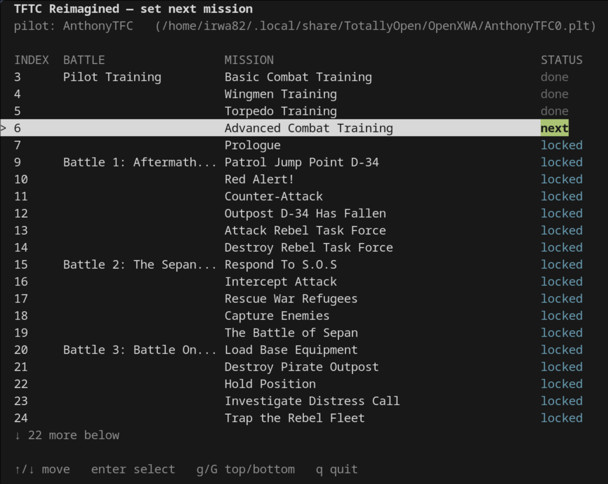

# xwa-pilot

I created this tool because I was playing the Tie Fighter Total Conversion Reimagined mod inside of OpenXWA on my Linux machine and the existing pilot editors for X-Wing Alliance was not editing the tie fighter pilot files properly.

This tool will set which tour-of-duty mission an X-Wing Alliance pilot file is about to fly. This could be the original X-Wing Alliance game, the XWAU mod or the TFTC mod or any future mods that have the `mission.lst` file. 



## Recommended Tools

If you are going to play the old Star Wars Flight Sims I recommend the following resources:

**Cross Platform Open Source Engine for X-Wing Alliance:**
- https://github.com/elyosh/OpenXWA

**Mods with updated graphics, screen res etc:**
- https://www.xwaupgrade.com/
- https://sites.google.com/view/tie-fighter-total-conversion

**Run the Original X-Wing and Tie Fighter Cross Platform:**
- https://github.com/elyosh/OpenXW
- https://github.com/elyosh/OpenTIE

## Which MISSION.LST to use

TFTC Reimagined and XWA Upgrade differ here, and passing the wrong one is the
most likely mistake.

| Mod | List to pass |
|-----|--------------|
| **TFTC Reimagined** | the mod's own: `<mods>/tftc-reimagined-1.4.0/game/Missions/MISSION.LST` |
| **XWA Upgrade 2025** | the **base original game's**: `<game>/Missions/MISSION.LST` |

### Why XWA Upgrade is different

XWA Upgrade does **not** ship a `MISSION.LST`. The game opens
`missions\mission.lst` through the asset VFS, which falls back to the stock
game's copy. So XWA Upgrade missions are ordered and numbered by the **base game
file**, with the mod supplying only the mission data.

There is nothing to point at inside the XWA Upgrade mod folder — pass the base
game's list. A mod path for XWA Upgrade will fail with "no such file".

The base game folder is wherever the game is installed, for example:

| Platform | Base game folder |
|----------|------------------|
| Linux (local copy) | `~/X-Wing/xwa-original/` |
| Windows | `C:\Program Files (x86)\GOG Galaxy\Games\Star Wars - X-Wing Alliance\` |
| macOS | `/Applications/OpenXWA.app/Contents/Resources/` |

If you are unsure, run `--list`: the mission names it prints should match the mod
you are about to play.

## Build

```sh
go build -o xwa-pilot .
```

Prebuilt binaries for Linux, Windows and macOS (Intel and Apple Silicon) are
published on the [releases page](https://github.com/anthonyirwin82/xwa-pilot/releases).
The release workflow is run manually from the Actions tab; it builds and uploads
the binaries for the tag you give it.

## Use

```
xwa-pilot --mission <MISSION.LST> --pilot <pilot.plt>
```

Single-dash forms work too (`-mission`, `-pilot`), and the two may be given in
either order. Run with no arguments for help.

### Where the files live

Mods directory by platform:

| Platform | Mods directory |
|----------|----------------|
| Linux   | `~/.local/share/TotallyOpen/OpenXWA/mods/` |
| macOS   | `~/Library/Application Support/TotallyOpen/OpenXWA/mods/` |
| Windows | `%LOCALAPPDATA%\TotallyOpen\OpenXWA\mods\` |

The pilot file sits one level up, in the OpenXWA data directory.

### Linux

TFTC Reimagined:

```sh
./xwa-pilot \
  --mission ~/.local/share/TotallyOpen/OpenXWA/mods/tftc-reimagined-1.4.0/game/Missions/MISSION.LST \
  --pilot   ~/.local/share/TotallyOpen/OpenXWA/AnthonyTFC0.plt
```

XWA Upgrade — note the mission list is the **base game's**, not the mod's:

```sh
./xwa-pilot \
  --mission ~/X-Wing/xwa-original/MISSIONS/MISSION.LST \
  --pilot   ~/.local/share/TotallyOpen/OpenXWA/AnthonyXWA0.plt
```

### macOS

TFTC Reimagined:

```sh
./xwa-pilot \
  --mission "$HOME/Library/Application Support/TotallyOpen/OpenXWA/mods/tftc-reimagined-1.4.0/game/Missions/MISSION.LST" \
  --pilot   "$HOME/Library/Application Support/TotallyOpen/OpenXWA/AnthonyTFC0.plt"
```

XWA Upgrade — base game's list:

```sh
./xwa-pilot \
  --mission "/Applications/OpenXWA.app/Contents/Resources/Missions/MISSION.LST" \
  --pilot   "$HOME/Library/Application Support/TotallyOpen/OpenXWA/AnthonyXWA0.plt"
```

### Windows

TFTC Reimagined:

```bat
xwa-pilot ^
  --mission "%LOCALAPPDATA%\TotallyOpen\OpenXWA\mods\tftc-reimagined-1.4.0\game\Missions\MISSION.LST" ^
  --pilot   "%LOCALAPPDATA%\TotallyOpen\OpenXWA\AnthonyTFC0.plt"
```

XWA Upgrade — base game's list (adjust the game path if not on Steam):

```bat
xwa-pilot ^
  --mission "C:\Program Files (x86)\GOG Galaxy\Games\Star Wars - X-Wing Alliance\Missions\MISSION.LST" ^
  --pilot   "%LOCALAPPDATA%\TotallyOpen\OpenXWA\AnthonyXWA0.plt"
```

## In the list

| Key | Action |
|-----|--------|
| `↑` / `k` | move up |
| `↓` / `j` | move down |
| `pgup` / `pgdown` | page |
| `g` / `G` | first / last |
| `enter` | choose the highlighted mission |
| `y` / `n` | confirm or cancel |
| `q` / `esc` | quit |

The mission the game would currently offer is marked **next**. Earlier missions
show **done**, later ones **locked**.

## Non-interactive use

```sh
# show the list and current progress, change nothing
./xwa-pilot --mission <MISSION.LST> --pilot <pilot.plt> --list

# set mission 17 without the UI
./xwa-pilot --mission <MISSION.LST> --pilot <pilot.plt> --set 17 --yes
```

## Safety

- The file must be exactly 152076 bytes (`sizeof(PilotData)`), otherwise it is
  rejected.
- The previous file is copied to `<pilot.plt>.bak` before any write.
- Only the tour-of-duty progress fields are modified. The rest of the file is
  written back unchanged; a test asserts the patch is idempotent and that no
  unrelated byte moves.

## Where the numbers come from

Offsets are taken from `src/xwa/frontend/mission_setup.h` in OpenXWA:

```
PilotData:
  missionDirectoryId          42
  missionDescriptionIds[7]    46
  tourOfDutyMissions[255]     44282
  campaignMode                151795

PilotMission (48 bytes each):
  numberTimesFlown            4
  completedCount              20
```

If upstream changes those structs, `pilot.go` and the tests will need updating.

## Notes

- **The game must be closed** when you run this. It rewrites the `.plt` on exit
  and would overwrite the change.
- Mission indices are the numbers in `MISSION.LST`, which are not contiguous
  (TFTC starts at 3 and skips 8). The tool follows the list order, not a
  numeric range.
- This only touches tour-of-duty progress. Skirmish progress
  (`combatChamberMissions`) is left alone.

## Release Downloads Notes

If you download from the github releases page at https://github.com/anthonyirwin82/xwa-pilot/releases then the filenames will have the OS and CPU Architecture in them so they are different for every system.

  You can rename them to be xwa-pilot to be the same as the examples in this README file. On Linux and macOS you will also need to make the file executable in the command line by running `chmod +x xwa-pilot` (Assuming you renamed the file to that).

